# Branchlight — Lambda Managed Instances feedback demo

A React + TypeScript dashboard and **one local Express collection process** collect retail feedback, export batches, and let an admin explore saved results. The separate worker classifies feedback, calculates metrics, and saves evidence. In AWS mode, an S3 object-created event invokes that worker on **Lambda Managed Instances**, and Amazon Bedrock supplies classification and question explanations.

## Run locally

Requires Node.js 22.12+ (Node 24 recommended), npm, and three available local ports/processes: Express on 3001, Vite on 5173, and a background worker without an HTTP port.

```sh
npm ci
cp .env.example .env
npm run dev
```

Open **http://127.0.0.1:5173**. `npm run dev` starts exactly one collector, one separate local worker, and Vite. The collector does not use a file watcher because automatic restarts would lose its memory buffer.

Default `DEMO_MODE=local` is explicitly a **simulation**: objects persist in `.demo-data/`, and the worker uses simple keyword rules rather than Bedrock. It is useful for rehearsing the full flow, but it does not demonstrate actual S3 notifications or Managed Instances. Local question answers illustrate the regional comparison for any question; AWS mode uses the actual question. No AWS credentials are required for local mode.

**Memory is temporary. Restarting Express loses all unexported feedback, including batches whose upload failed.** Exported objects survive. Production must replace collection memory with durable storage. Do not run multiple Express replicas, PM2 cluster mode, or a serverless HTTP collector: each would have an independent buffer.

## Teaching sequence

1. Open **Collect feedback**. Submit positive, negative, and mixed comments across branches. Branch selection adds the configured country and region on the server.
2. Choose **Generate sample feedback** for 24 responses spanning six Nigerian branches. Select **200 · full batch** in the sample count control to demonstrate the automatic export threshold in one click. The collection endpoint validates and confirms immediately; it never calls the model.
3. Show the in-memory buffer count. Click **Flush batch now** to export up to 200 responses. Otherwise export starts at 200 or 30 minutes after the oldest buffered submission, whichever is first.
4. Open the source JSON link in **Batch activity**. Each batch is a single JSON object under `batches/YYYY-MM-DD/HH-mm/batch-<uuid>.json` (UTC).
5. Follow classification → aggregation → transformation. In AWS, watch the status object and CloudWatch logs; small local batches may finish between dashboard polls.
6. Compare regional average ratings and sentiment. Filter by branch and inclusive UTC submission dates. Default dates are Monday through today in UTC.
7. Ask **“Which region had the worst reviews this week?”** The selected filters are authoritative, even if the wording of a question mentions another period. Click supporting comments to see full feedback, topic excerpts, IDs, timestamps, and the source object. The answer is saved under `reports/`.
8. Point out **“Data processed through…”**, pending/failed batches, buffered responses, and partial-result warnings. This is the latest processed submission timestamp, **not a completeness watermark**. An older batch can still be missing. The report captures its coverage snapshot so later completion does not silently change an earlier answer.

This demonstrates batch processing and Managed Instances integration. **It does not assume Managed Instances is cheaper than standard Lambda for an intermittent workload.** Capacity providers allocate EC2 capacity; inspect pricing and remove workshop compute when finished.

## AWS mode

See [infra/README.md](infra/README.md) for packaging, prerequisites, a CloudFormation deployment, and replay/cleanup instructions. The template includes:

- A Lambda capacity provider with an operator role and supplied VPC subnets/security groups.
- A separate Node.js 22 worker, a published version, and a `live` alias.
- A private S3 bucket whose **only** notification is object creation under `batches/` ending in `.json`, targeting the worker alias.
- Scoped worker permissions, an attachable policy for the local operator, asynchronous retries, and an SQS dead-letter queue.

After deployment, set `.env`:

```dotenv
DEMO_MODE=aws
AWS_REGION=your-deployment-region
S3_BUCKET=your-stack-output-bucket
BEDROCK_MODEL_ID=your-enabled-model-or-inference-profile
```

Authenticate the AWS SDK using your normal local AWS profile/SSO credentials, then run:

```sh
npm run dev:aws
```

This starts the local Express server and React UI. **Do not run the local worker in AWS mode**. S3 invokes the deployed worker independently. The same configured model can classify feedback and explain results through different versioned prompts; each call carries its own data, without conversational memory.

The app is an unauthenticated local teaching tool. It binds to loopback and rejects cross-site browser origins. AWS credentials stay in Node and are never sent to React. Public deployment would require authentication and access controls.

## How the data flows

```mermaid
flowchart LR
  Form[React feedback form] --> Express[One local Express process]
  Express --> Buffer[Temporary memory buffer]
  Buffer -->|200 / 30 min / manual flush| Batch[S3 batches/]
  Batch -->|ObjectCreated notification| Worker[Lambda Managed Instances worker]
  Worker -->|Small classification requests| Model[Amazon Bedrock]
  Worker --> Status[S3 status/]
  Worker --> Processed[S3 processed/]
  Admin[React admin dashboard] --> Express
  Processed --> Express
  Express -->|Calculated metrics + evidence| Model
  Express --> Reports[S3 reports/]
```



| Prefix       | Contents                                                                                                                                              |
| ------------ | ----------------------------------------------------------------------------------------------------------------------------------------------------- |
| `batches/`   | Immutable original batch: schema version, batch ID, export time, feedback records                                                                     |
| `status/`    | Per-batch stage, processing/completed/failed state, timestamps, source, error                                                                         |
| `processed/` | One canonical object per batch: individual classifications, exact supporting excerpts, metrics, source, processing duration, model and prompt version |
| `reports/`   | Saved answer/management brief: question, filters, calculated comparison, evidence, source batches, coverage, model/prompt version                     |

Each classification preserves the original feedback ID. A batch is downloaded once per worker attempt, then split into requests of `MODEL_REQUEST_SIZE` (10 by default, configurable 1–20). Model output is validated for complete/unique IDs, allowed sentiments/topics, unique topics, and excerpts that literally occur in the original comment. Invalid or truncated output fails the batch and leaves it retryable. No partial metrics are committed.

The output carries response counts, rating totals, sentiment counts, topic counts and per-topic sentiments by branch and region, plus daily metrics. Dashboard filtering recomputes the selected totals from the saved classified records, including when a batch crosses a date boundary. It never averages batch averages. For example, a batch with one 1-star response plus a batch with nine 5-star responses gives **46 / 10 = 4.6**, not 3.0.

Regions rank by **lowest average star rating**, then higher negative share, then alphabetical region name. Mixed sentiment is its own category, not silently counted as negative. Counts remain visible because small samples do not establish population-wide conclusions. The model receives the calculated ranking and up to ten lowest-rated comments per region (30 total); excerpts are illustrative evidence, not proof of a cause. Unknown evidence IDs in answers are rejected. The numerical comparison table comes directly from code.

## Retry and duplicate guarantees

- A single in-flight export promise serializes flush requests. The immutable pending batch keeps its ID, timestamp, object key, and record membership across retries. Incoming feedback stays in the buffer separately.
- The batch remains in memory until the S3 upload succeeds. A conditional create (`If-None-Match: *`) prevents overwrites. If an upload succeeded but its response was lost, the retry reads and verifies the existing object before removing buffered records. Failed uploads retry after five seconds.
- Automatic draining exports additional full batches after a successful upload. Partial remainders retain the oldest response's deadline. The buffer has a configurable limit (10,000 by default); failures never trigger silent dropping of existing records.
- S3 notifications are at least once. A worker first checks `processed/<batch-id>.json`, and commits with conditional creation. Concurrent attempts may both call Bedrock, but only one result wins. This guarantees one stored contribution per batch, **not exactly-once model invocation**.
- Status uses conditional ETag updates. A late failure cannot overwrite a completed state. The committed processed object is authoritative; a retry repairs a missing final status write. Dashboard records are additionally deduplicated by feedback ID.
- Lambda errors propagate to AWS retry handling. After retries are exhausted, inspect the dead-letter queue and replay the event after fixing the cause. A timed-out/terminated attempt may leave a processing status; that batch stays pending in coverage until successfully replayed. The worker uses a deadline abort signal, including for Bedrock calls.

## Verification

```sh
npm run typecheck        # strict checks for API, UI, shared contracts, tests and scripts
npm test                 # backend/domain/API tests
npm run build            # production React build + bundled worker
npm run package:worker   # dist/worker.zip + SHA256 for CloudFormation
npx playwright install chromium
npm run test:e2e          # real browser teaching flow + mobile layout
```

If Chrome is already installed, `PLAYWRIGHT_CHANNEL=chrome npm run test:e2e` uses it. Browser tests start isolated local processes, use a temporary object directory, and stop their servers afterward. They require ports 3001 and 5173 to be available. Screenshots are generated under the ignored `test-results/` directory.

The backend tests cover retry identity, upload acknowledgement loss, concurrent flushes and arrivals, automatic size/time export, automatic upload retry, buffer limits, chunking, duplicate S3 events, failed-model recovery, strict evidence validation, weighted metrics, branch/date filtering, partial coverage, saved reports, event filtering, aborts, S3 pagination/conditions, and HTTP integration.

AWS deployment and live Bedrock behavior need validation in your account: model access, regional availability, IAM policies, service quotas, and network connectivity are environment-specific. Local tests use injected storage/model adapters, not live AWS services.

## Demo boundaries

- Six example branches are defined in `shared/src/index.ts`; edit that catalog for your teaching context.
- Date semantics are UTC, while the UI renders timestamps in the browser's local timezone with a timezone label.
- Dashboard requests scan exported batches and read saved output. The pending-batch path may read original objects to identify the relevant submission dates. This is intentionally small-scale; production needs a query index, caching, pagination, durable collection, and a recovery process.
- The local filesystem adapter supports one local worker. Distributed conditional-write correctness is provided by S3 in AWS mode.
- The UI polls every three seconds. “As of” coverage is a snapshot starting at the query time; later submissions appear on the next refresh. No system can reconstruct feedback lost before export from this demo's process memory.

## TypeScript structure

All application code, tests, tooling, and configuration use `.ts` or `.tsx`. The API runs TypeScript with `tsx` without watch mode (one collection process); Vite handles TSX. `shared/src/index.ts` defines the Zod schemas and inferred types used by both workspaces. API responses and persisted batch/status/results are validated at runtime. The strict TypeScript checks are part of `npm run build`; `npm run build:worker` also checks the backend before bundling its deployable JavaScript artifact.

The UI separates the HTTP client (`ui/src/api.ts`), independent buffer/dashboard polling (`ui/src/hooks/useDashboard.ts`), feedback form, evidence dialog, and display components. Changing filters aborts obsolete dashboard/question requests. Buffer polling continues even when a date filter is invalid. Failed uploads retain an absolute retry deadline, so continuous submissions cannot keep postponing retry.
